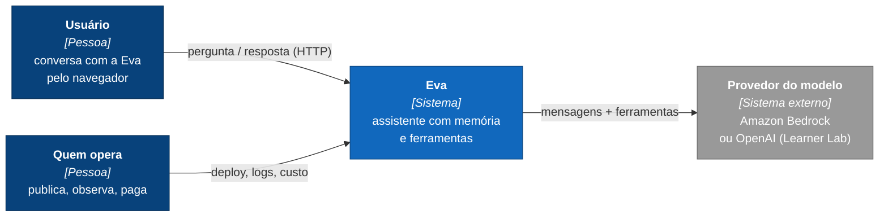
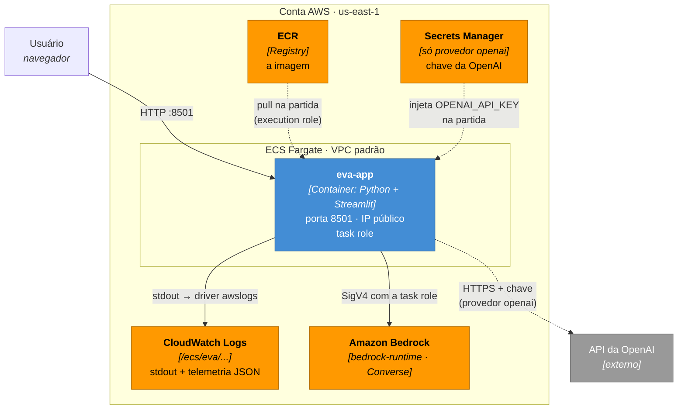
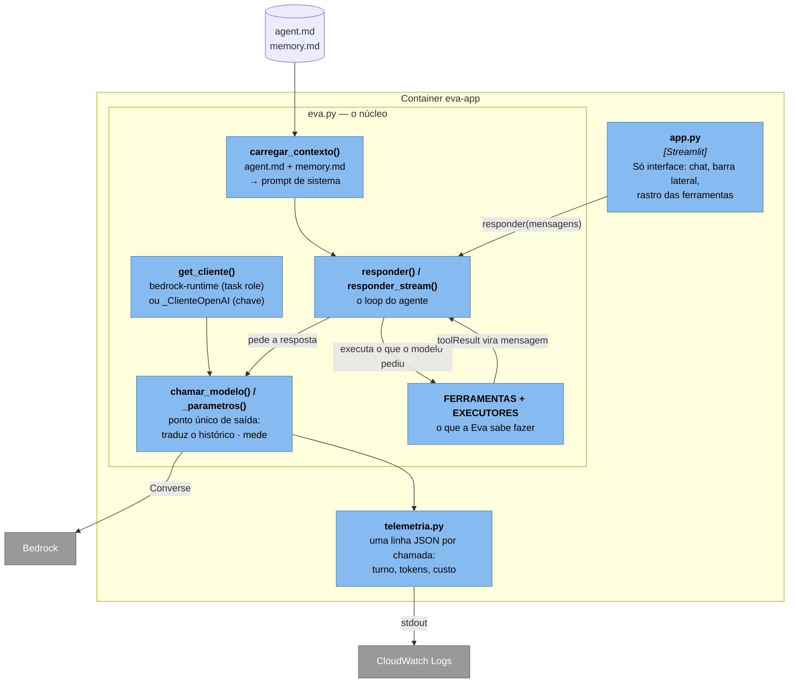
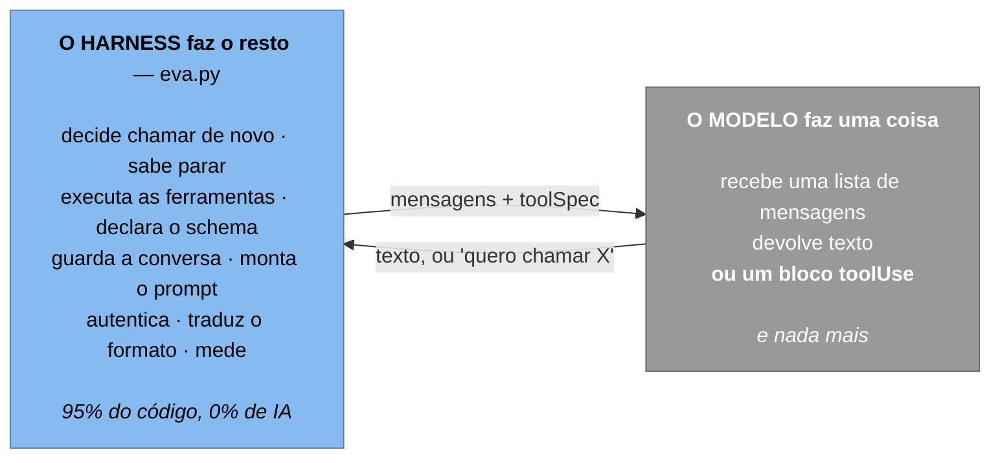
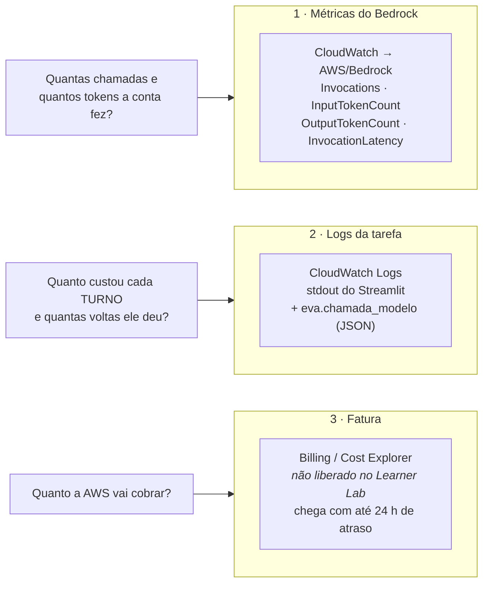
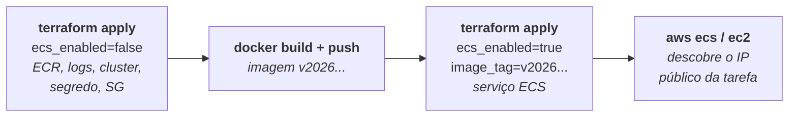
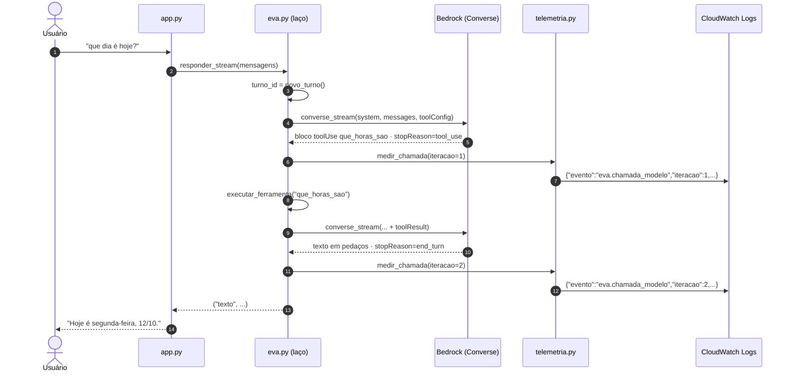

# Diagramas da solução — Eva na AWS

Modelo **C4**, de fora para dentro. Cada nível responde a uma pergunta
diferente, e cada um tem um público diferente:

| Nível | Pergunta | Para quem |
|---|---|---|
| **1. Contexto** | Quem usa o sistema e com o que ele fala? | qualquer pessoa |
| **2. Contêineres** | De que peças executáveis ele é feito? | quem opera e quem desenvolve |
| **3. Componentes** | O que existe dentro da aplicação? | quem vai mexer no código |
| **4. Código** | Como cada componente é escrito? | (o próprio código; não desenhamos) |

> A regra do C4 que mais economiza discussão: **um diagrama, um nível de
> abstração**. Misturar "usuário" com "função Python" no mesmo desenho é o que
> transforma diagrama em decoração.

---

## Nível 1 — Contexto

O nível 1 **não muda** entre Azure e AWS, nem entre Bedrock e OpenAI. É o
teste de que ele está no nível certo: troca de nuvem é detalhe de nível 2.

---

## Nível 2 — Contêineres

**As setas tracejadas acontecem uma vez, na partida da tarefa.** As cheias,
a cada pergunta. A diferença importa para segurança: a chave da OpenAI cruza a
rede **uma** vez, puxada pelo agente do ECS — o código nunca chama o Secrets
Manager.

**Duas roles, um nome (no Learner Lab).** A task definition tem dois campos:

| Campo | Quem usa | Para quê |
|---|---|---|
| `executionRoleArn` | o **agente do ECS** | puxar a imagem do ECR, ler o segredo, escrever no CloudWatch |
| `taskRoleArn` | o **seu código** | chamar o Bedrock |

No Learner Lab as duas são a `LabRole`, porque não se cria role. Numa conta de
verdade, são duas roles com permissões diferentes — `criar_role = true` no
Terraform mostra o começo disso.

### Equivalência com a versão Azure

| Azure | AWS | Observação |
|---|---|---|
| Azure Container Apps | **ECS Fargate** | sem load balancer: IP público por tarefa |
| Container Registry (ACR) | **ECR** | login com a credencial da sessão |
| Managed Identity | **task role** | credencial temporária entregue pelo ECS |
| Key Vault | **Secrets Manager** | só existe no caminho com chave |
| Application Insights | **CloudWatch Logs + Logs Insights** | JSON no stdout, sem SDK |
| Microsoft Foundry | **Amazon Bedrock** | ou OpenAI, onde o Bedrock não está liberado |
| tags + Azure Policy | **`default_tags`** do provider | tag em todo recurso, sem herança manual |

---

## Nível 3 — Componentes da aplicação

Agora dentro do `eva-app`. Cada caixa é um módulo ou uma função com
responsabilidade própria.

**Por que `chamar_modelo()` é o componente mais importante do desenho:** é o
**ponto único de saída**. Traduzir o histórico para a Converse e medir a
chamada foram escritos **uma vez** e valem para os dois caminhos. Se essa
lógica estivesse duplicada, toda correção precisaria ser feita em dois
lugares — e mais cedo ou mais tarde só um deles seria corrigido.

**E por que `get_cliente()` devolve algo com a mesma cara nos dois
provedores.** O `_ClienteOpenAI` expõe `converse()` e `converse_stream()`
como se fosse o `bedrock-runtime`. O laço não sabe com quem fala. Trocar de
provedor muda uma borda, não o agente.

### O mesmo nível, por outra lente: o harness

O [ANATOMIA-DO-HARNESS.md](ANATOMIA-DO-HARNESS.md) abre a caixa azul: o
diagrama do laço passo a passo, as dez responsabilidades com número de linha, e
a lista honesta do que este harness ainda **não** faz.

---

## Observabilidade — as três janelas

Nenhum dos diagramas acima mostra **quem consegue ver o quê**:

| Janela | Sabe | Não sabe |
|---|---|---|
| **Métricas do Bedrock** | volume, tokens e latência por modelo, sem instrumentar nada | o que é um turno; quem perguntou; nada do provedor openai |
| **Logs da Eva** | turno, iteração, tokens, custo estimado, erro | o preço real (usa a tabela que você configurou) |
| **Fatura** | o valor cobrado | o porquê |

Nenhuma sozinha basta — o [LAB-OBSERVABILIDADE.md](LAB-OBSERVABILIDADE.md)
cruza as três.

---

## Provisionamento — um caminho, três movimentos

O `infra/deploy.sh` faz os quatro. Por que não um apply só: o serviço ECS
precisa de uma imagem que ainda não existe no primeiro apply — o mesmo
ovo-e-galinha da Aula 3.

---

## Sequência — uma pergunta, do clique à resposta

Uma pergunta, **duas** chamadas ao modelo, **duas** linhas de log com o mesmo
`turno_id`. É por isso que o custo que importa é por turno, não por chamada.

---

## O que os diagramas deixam de fora, de propósito

- **Rede** — não há load balancer, HTTPS nem subnet privada. A tarefa tem IP
  público e a porta 8501 aberta para `cidr_acesso`. Em produção: ALB com
  certificado do ACM, tarefa em subnet privada, VPC endpoint para o Bedrock.
- **Estado** — não há banco. O histórico vive na memória do processo, e a
  `memory.md` está *dentro da imagem*: o que a Eva "aprender" some quando a
  tarefa é trocada. É a limitação mais importante desta arquitetura.
- **Escala** — uma tarefa. Com duas, dois usuários veriam memórias diferentes.
- **CI/CD** — o deploy é um script rodado à mão. Não há pipeline, homologação
  nem rollback automático.
- **Autenticação do usuário** — qualquer um com o IP conversa com a Eva (e
  gasta o seu dinheiro). Restrinja `cidr_acesso` ao seu IP fora da aula.

Bom exercício de arquitetura: **qual caixa você acrescentaria primeiro?**
(Uma resposta defensável: um armazenamento externo para o estado — DynamoDB
para a conversa, S3 para o `memory.md` — e reparar que isso muda o nível 2,
não o nível 1.)
