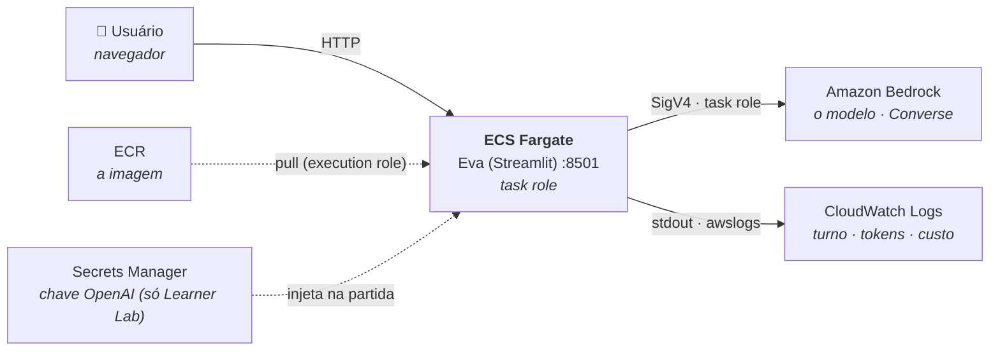

# Eva (AWS)

A Eva rodando **inteira na AWS**: aplicação em container no **ECS Fargate**,
imagem no **ECR**, modelo no **Amazon Bedrock** chamado com a **task role**
(sem chave), e telemetria — turno, tokens e custo — no **CloudWatch Logs**.

> ⚠️ **Learner Lab:** o Bedrock não é liberado no AWS Academy. Ali a Eva roda
> com `provedor = "openai"`: a chave da OpenAI fica no **Secrets Manager** e o
> ECS a injeta no container. O deploy, a imagem, os logs e o FinOps são os
> mesmos — só o provedor do modelo muda. A versão com Bedrock é a demo do
> professor, numa conta comum.

> 📘 **Dois guias, na ordem de aprendizado:**
>
> 1. [GUIA-DEPLOY-CLI.md](Documentacao/GUIA-DEPLOY-CLI.md) — publica com um
>    script (Terraform + Docker) e explica cada passo.
> 2. [GUIA-DEPLOY-CONSOLE.md](Documentacao/GUIA-DEPLOY-CONSOLE.md) — percorre
>    no console o que foi criado: para entender e para investigar incidente.

---

## A arquitetura



No caminho Bedrock, **nenhum segredo existe**: o ECS entrega ao container uma
credencial temporária da task role, e a política IAM decide o que ela pode.
As setas tracejadas acontecem uma vez, na partida da tarefa.

---

## Rodar na sua máquina

```bash
git clone https://github.com/IsaiasBritto/aie-cloud.git
cd aie-cloud/aulas/05-bedrock-agents/03-agente-Eva-aws

python -m venv .venv
source .venv/bin/activate            # Windows: .\.venv\Scripts\Activate.ps1
pip install -r requirements.txt
cp .env.example .env                 # provedor, modelo e (se openai) a chave
python verificar.py
streamlit run app.py
```

Com `EVA_PROVEDOR=bedrock`, o boto3 usa o `aws configure` aqui e a task role
lá — mesmo código, dois ambientes.

## Publicar na AWS

No CloudShell (detalhes no [GUIA-DEPLOY-CLI.md](Documentacao/GUIA-DEPLOY-CLI.md)):

```bash
cd ~/aie-cloud/aulas/05-bedrock-agents/03-agente-Eva-aws/infra
cp terraform/terraform.tfvars.example terraform/terraform.tfvars   # edite
read -rsp "Chave da OpenAI: " TF_VAR_openai_api_key && export TF_VAR_openai_api_key && echo   # Learner Lab
bash deploy.sh
```

---

## O que mudou em relação à Eva-local-to-bedrock

| | local-to-bedrock | **aws** |
|---|---|---|
| Credencial | `aws configure` na sua máquina | **task role** do ECS |
| Onde a chave mora (provedor openai) | — | **Secrets Manager**, injetada pelo ECS |
| Observabilidade | nenhuma | **uma linha JSON por chamada** no CloudWatch |
| Empacotamento | nenhum | **Dockerfile** (base do ECR Public) |
| Infra | nenhuma | **Terraform**: ECR, ECS, logs, SG, segredo, IAM opcional |
| Onde roda | sua máquina | **ECS Fargate** |

O loop do agente, as ferramentas, o `agent.md` e o `memory.md` continuam
**idênticos**. O provedor `openai` entra por um **adaptador**
(`_ClienteOpenAI`) que fala a língua da Converse — o laço não sabe com quem
está falando.

---

## Arquivos

```text
03-agente-Eva-aws/
├── eva.py                    # o agente (get_cliente: task role, ou chave do Secrets Manager)
├── app.py                    # interface Streamlit
├── telemetria.py             # JSON no stdout → CloudWatch: turno, tokens, custo
├── verificar.py              # diagnóstico: provedor, identidade, modelo, telemetria
├── agent.md / memory.md      # inalterados
├── Dockerfile / .dockerignore
├── requirements.txt
├── .env.example              # só para rodar local
├── infra/
│   ├── deploy.sh             # apply → build/push → apply → IP público
│   ├── custo.sh              # custo por turno via Logs Insights
│   ├── consulta-custo.logsinsights
│   └── terraform/            # ECR, ECS Fargate, CloudWatch, Secrets Manager, IAM
└── Documentacao/
    ├── GUIA-DEPLOY-CLI.md        # passo a passo por comando
    ├── GUIA-DEPLOY-CONSOLE.md    # o que foi criado, no console
    ├── DIAGRAMAS.md              # C4 níveis 1 a 3 + observabilidade + sequência
    ├── ANATOMIA-DO-HARNESS.md    # o que existe entre o modelo e o mundo
    ├── LAB-OBSERVABILIDADE.md    # medir: Logs Insights, iterações por turno
    └── LAB-FINOPS.md             # decidir: custo por turno, as cinco alavancas
```

**Ordem de leitura**, depois de publicar: `DIAGRAMAS.md` →
`ANATOMIA-DO-HARNESS.md` → `LAB-OBSERVABILIDADE.md` → `LAB-FINOPS.md`.

---

## Telemetria

Cada chamada ao modelo vira **uma linha JSON** no stdout. No ECS, o driver
`awslogs` leva ao CloudWatch Logs — sem SDK, sem permissão extra no código:

```json
{"evento": "eva.chamada_modelo", "turno_id": "7e5b086b7f65", "iteracao": 2,
 "provedor": "bedrock", "modelo": "us.amazon.nova-lite-v1:0", "streaming": true,
 "duracao_ms": 812.4, "tokens_entrada": 1840, "tokens_saida": 37,
 "custo_estimado_usd": 0.00011928, "erro": null, "falhou": 0}
```

O `turno_id` é o que importa: uma pergunta pode custar várias chamadas (uma
por volta do laço de ferramentas), e **custo por turno** é o número que vai
para a reunião. A consulta que o calcula está em `infra/consulta-custo.logsinsights`
e é a mesma do Lab 3 da Aula 06.

Localmente a telemetria fica desligada (`EVA_TELEMETRIA` vazia).
**O custo sai zerado** até você preencher os preços do seu modelo — de
propósito: preço inventado em painel de custo é pior que painel nenhum.

---

## Custo

- **ECS Fargate** cobra por hora **ligado**, com ou sem pergunta:
  0,5 vCPU + 1 GB ≈ US$ 0,025/h, mais US$ 0,005/h do IP público. Ao contrário
  do Container Apps com `min-replicas 0`, **não escala a zero sozinho**.
- **ECR**, **CloudWatch Logs** (retenção 7 dias) e **Secrets Manager** são
  centavos.
- O **modelo** é cobrado por token.

Ao fim da aula:

```bash
terraform -chdir=infra/terraform destroy -auto-approve
```

---

## O que ainda falta para chamar de produção

1. **Autenticação de usuário** — a porta 8501 é pública. Um ALB com
   autenticação do Cognito resolve sem código.
2. **HTTPS e rede privada** — ALB + certificado do ACM; tarefa em subnet
   privada; VPC endpoint para o Bedrock.
3. **Estado remoto do Terraform** — o `terraform.tfstate` fica no CloudShell
   e, com `openai`, contém a chave. Em uso real vai para um backend S3 com
   criptografia, versionamento e lock.
4. **CI/CD** — build e deploy no GitHub Actions com OIDC, em vez de no
   CloudShell.
5. **Memória compartilhada** — `memory.md` vive no container e some a cada
   deploy. Precisa de S3, DynamoDB ou EFS.
6. **Testes** — nenhum.

O item 5 é o que quebra primeiro em uso real, e é o menos óbvio: a Eva
"esquece" tudo a cada deploy porque a memória está no sistema de arquivos de
uma tarefa efêmera.
