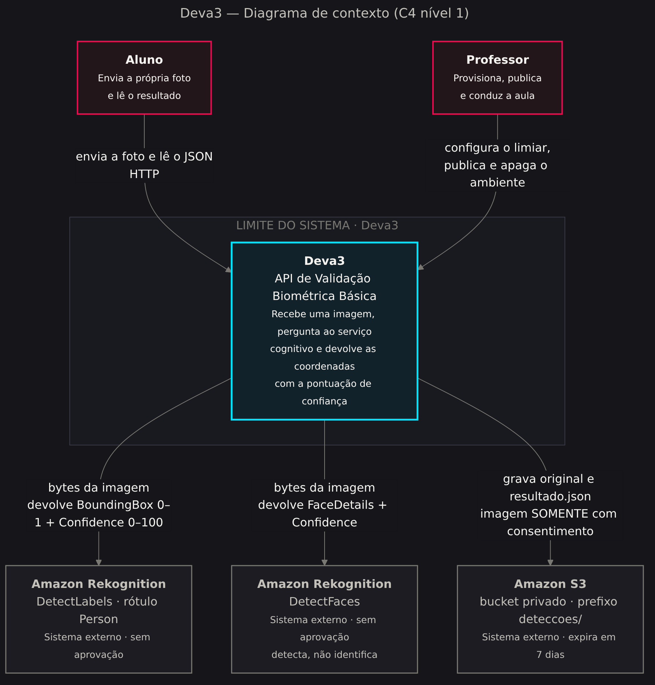
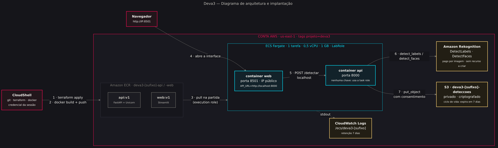
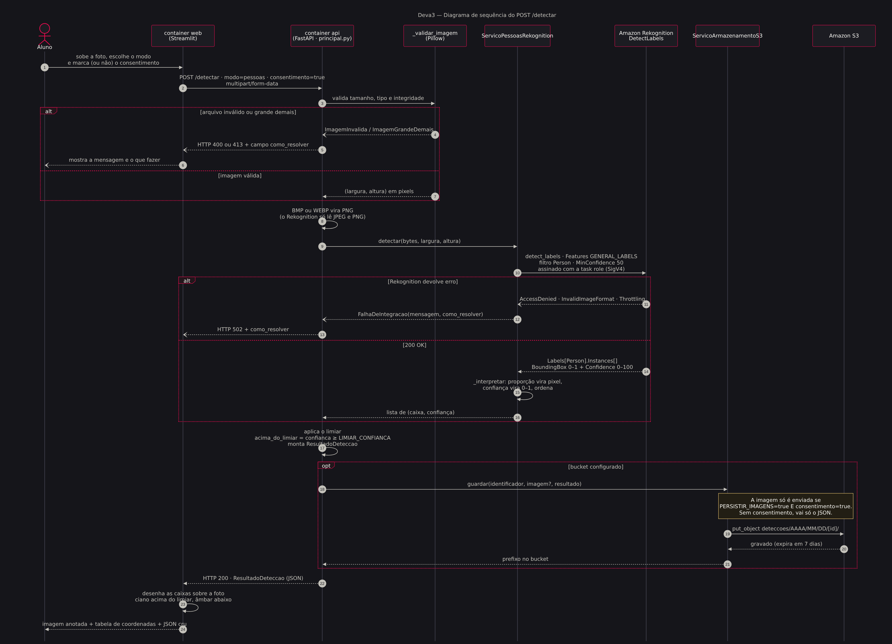

# Manual 0 — Os três diagramas do Deva3

> **Leia este documento antes dos outros.** Ele responde, em três desenhos, as três
> perguntas que todo aluno faz na primeira meia hora:
>
> 1. **Com quem esse sistema conversa?** → diagrama de contexto
> 2. **Onde cada pedaço roda?** → diagrama de arquitetura
> 3. **O que acontece quando eu clico em "Analisar"?** → diagrama de sequência
>
> As imagens estão em `docs/imagens/` e o **código-fonte** de cada uma está em
> `docs/diagramas/*.mmd` — é Mermaid, texto puro, versionado junto com o projeto.
> Se o desenho ficar errado, você corrige o `.mmd` e gera de novo. Diagrama que não
> pode ser corrigido apodrece.

---

## Como regerar os diagramas

```bash
npm install -g @mermaid-js/mermaid-cli      # uma vez por máquina

mmdc -i docs/diagramas/01-contexto.mmd   -o docs/imagens/01-contexto.png \
     -c docs/diagramas/tema-fiap.json -b "#15151A" -w 2200 --scale 2
mmdc -i docs/diagramas/02-arquitetura.mmd -o docs/imagens/02-arquitetura.png \
     -c docs/diagramas/tema-fiap.json -b "#15151A" -w 2200 --scale 2
mmdc -i docs/diagramas/03-sequencia.mmd  -o docs/imagens/03-sequencia.png \
     -c docs/diagramas/tema-fiap.json -b "#15151A" -w 2200 --scale 2
```

O arquivo `tema-fiap.json` traz a paleta da disciplina (fundo `#15151A`, magenta
`#EB0B4F`, ciano `#03E3FD`, âmbar `#FFD579`), então todo diagrama novo já nasce no
padrão do material.

⚠️ **Armadilha do Mermaid:** dentro de mensagens de diagrama de sequência, evite `&`,
`;`, `>` e entidades HTML como `&lt;`. O analisador quebra e a mensagem de erro não diz
que foi isso. Use `·`, `≥` e colchetes.

---

# 1 · Diagrama de contexto

**Pergunta que ele responde:** com quem o Deva3 conversa, e onde termina a nossa
responsabilidade.

É o **nível 1 do modelo C4**: só pessoas, o nosso sistema, e os sistemas externos.
Nenhum detalhe de tecnologia interna — de propósito.



📄 Fonte: [`diagramas/01-contexto.mmd`](diagramas/01-contexto.mmd)

### Como ler

| Elemento | O que significa |
|---|---|
| **Caixas magenta** | Pessoas. O **aluno** envia a foto; o **professor** provisiona, publica e define o limiar |
| **Caixa ciano** | O nosso sistema. Tudo que está dentro do "limite do sistema" é responsabilidade nossa |
| **Caixas cinza** | Sistemas externos. Nós **usamos**, não controlamos |

### As três leituras que valem discussão em aula

1. **O limite do sistema é pequeno de propósito.** O Deva3 recebe, pergunta e devolve.
   Ele não treina modelo, não guarda template biométrico, não identifica pessoa.
2. **Três dependências externas, uma credencial.** Rekognition (duas APIs) e S3 usam a
   mesma role. Sessão do Learner Lab expirada derruba as três de uma vez — e cada erro
   chega com um `como_resolver` diferente na API.
3. **A seta para o S3 tem uma condição escrita.** "SOMENTE com consentimento" está no
   desenho, não numa nota de rodapé. Se a regra é importante, ela aparece no diagrama.

---

# 2 · Diagrama de arquitetura

**Pergunta que ele responde:** onde cada pedaço roda, e por onde o código sai da sua
máquina e chega à nuvem.



📄 Fonte: [`diagramas/02-arquitetura.mmd`](diagramas/02-arquitetura.mmd)

### Como ler

Os números nas setas são a **ordem em que as coisas acontecem no laboratório**:

| # | O que é | Comando ou ação |
|---|---|---|
| **1** | Do CloudShell para a conta | `terraform apply` — bucket, ECR, cluster, logs, SG |
| **2** | Do CloudShell para o registro | `docker build` + `docker push` — o CloudShell tem Docker |
| **3** | Do registro para a tarefa | o ECS puxa as imagens com a *execution role* |
| **4** | O aluno abre a interface | `http://<IP público da tarefa>:8501` |
| **5** | A interface chama a API | `POST /detectar` em `localhost:8000` — mesma tarefa |
| **6** | A API chama o serviço cognitivo | `detect_labels` / `detect_faces`, assinados com a task role |
| **7** | A API grava o resultado | `put_object` no bucket privado, prefixo `deteccoes/` |

### O que o desenho mostra e o texto esconde

- **Tudo dentro da moldura magenta carrega a tag `projeto = deva3`** (`default_tags`
  do Terraform). É assim que se acha — e se apaga — o laboratório inteiro.
- **Os dois containers estão na mesma tarefa**, mas são imagens e processos
  separados. A fronteira entre backend e frontend é real; só não precisa de rede
  entre eles (`localhost`).
- **Nenhuma chave aparece no desenho, nem dentro das caixas.** Na versão Azure havia
  segredos (`visao-chave`, `armazenamento-conexao`). Aqui não existe segredo: a
  credencial é a role da tarefa, temporária, entregue pelo ECS.
- **Não há "escala a zero"**: a tarefa Fargate cobra enquanto estiver de pé. Fora da
  aula, `99-remover-tudo.sh` (ou `desired-count 0`).
- **O Rekognition não tem caixa de "recurso criado"**: é API pronta. Não há nível
  gratuito a esgotar por recurso nem endpoint a configurar — paga-se por imagem.

### Exercício de 5 minutos

Peça à turma para apontar, no desenho, **onde estaria o problema** em cada caso:

| Sintoma | Onde olhar no diagrama |
|---|---|
| A interface abre mas dá "API não respondeu" | seta 5 — `API_URL` ou o container `api` caiu |
| `ExpiredTokenException` ao rodar local | seta 6 — sessão do Learner Lab vencida |
| `CannotPullContainerError` na tarefa | seta 3 — etiqueta que não existe no ECR |
| `ModuleNotFoundError: api` | seta 2 — imagem construída da pasta errada |

---

# 3 · Diagrama de sequência

**Pergunta que ele responde:** o que acontece, passo a passo, entre clicar em
"Analisar imagem" e ver a caixa desenhada na tela.



📄 Fonte: [`diagramas/03-sequencia.mmd`](diagramas/03-sequencia.mmd)

### Como ler

- **Linhas verticais** são participantes: pessoas, containers, classes do nosso código
  e serviços da AWS. Repare que `_validar_imagem`, `ServicoPessoasRekognition` e
  `ServicoArmazenamentoS3` aparecem como participantes — eles são objetos reais do
  projeto, não abstrações do desenho.
- **Setas cheias** são chamadas; **setas tracejadas** são respostas.
- **Blocos `alt`** são caminhos alternativos: ou um, ou outro.
- **Bloco `opt`** é um trecho que só acontece sob condição.
- **Os números** seguem a ordem real da execução — dá para acompanhar de ponta a ponta.

### Os momentos que valem parar a aula

**Passos 3 a 7 · a validação vem antes de tudo.**
A imagem é checada em tamanho, tipo e integridade **antes** de qualquer chamada paga.
Arquivo ruim nunca vira custo na AWS. Os erros já saem com `como_resolver` preenchido.

**Passo 8 · o formato que o serviço aceita não é o que o aluno manda.**
O Rekognition só lê JPEG e PNG. BMP e WEBP viram PNG antes da chamada — e a API avisa.

**Passos 11 a 13 · o caminho de erro é tão desenhado quanto o de sucesso.**
`AccessDenied`, `InvalidImageFormat` e `Throttling` viram `FalhaDeIntegracao` e chegam
ao aluno como `502` com instrução. Diagrama que só mostra o caminho feliz esconde metade
do sistema.

**Passo 15 · a tradução acontece num lugar só.**
`_interpretar` converte a `BoundingBox` em **proporção** para pixels e a `Confidence`
de **0–100** para 0–1. Conversão espalhada é como nasce bug de coordenada — e esta tem
duas escalas para errar.

**Passo 17 · o limiar é aplicado pela API, não pela tela.**
`acima_do_limiar = confianca ≥ LIMIAR_CONFIANCA` acontece no backend. A interface só
pinta: ciano acima, âmbar abaixo.

**Passos 18 a 21 · o consentimento decide o que é gravado.**
A imagem só sobe se `PERSISTIR_IMAGENS=true` **e** o consentimento estiver marcado.
Sem consentimento, vai só o JSON. E o que sobe expira em 7 dias, por regra do bucket.

---

## Onde cada diagrama entra na aula

| Momento | Diagrama | Por quê |
|---|---|---|
| Abertura, antes de qualquer comando | **Contexto** | Define o escopo e já abre a conversa de responsabilidade |
| Antes do `01-criar-recursos.sh` | **Arquitetura** | O aluno cria cada caixa sabendo para que ela serve |
| Depois do primeiro teste com foto | **Sequência** | Explica o que o aluno acabou de ver acontecer |
| Quando algo quebra | **Arquitetura + Sequência** | Localizar o problema no desenho é mais rápido que ler log |

---

## Para onde ir agora

- **O que foi criado, tela a tela no console** → [`01-manual-console.md`](01-manual-console.md)
- **Provisionar por script** → [`02-manual-script.md`](02-manual-script.md)
- **Como o projeto foi construído** → [`03-passo-a-passo-do-zero.md`](03-passo-a-passo-do-zero.md)
